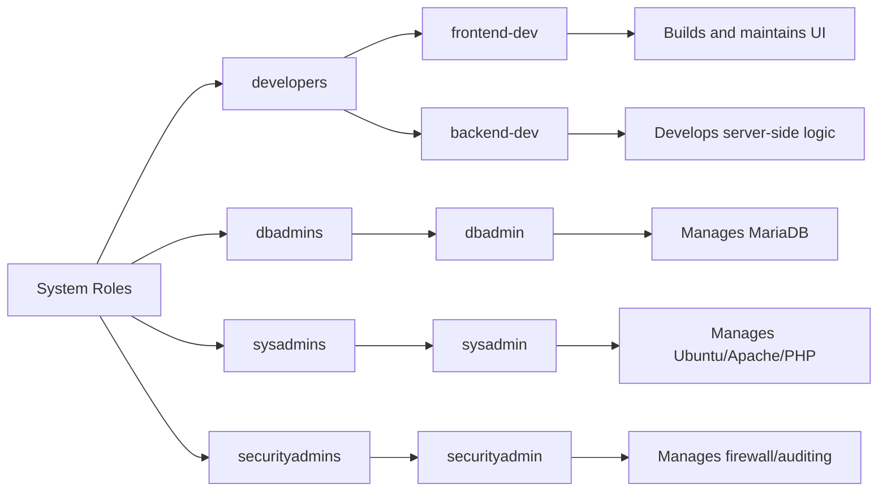

# USERS

Different users need to be created for managing different aspects of a website. For the website that will be running on the current server, the users and groups were divided as follows. 


The following commands were used to create these groups and users, 
1. Adding all the required users:
```bash
nikhil@vm-583017-ubuntu:~$ for user in {frontend-dev,backend-dev,dbadmin,sysadmin,securityadmin}; do 
sudo useradd $user 
done 
```
2. Adding all the required groups:
```bash
nikhil@vm-583017-ubuntu:~$ for group in {developers,dbadmins,sysadmins,securityadmins}; do 
sudo groupadd $group 
done 
```
3. Adding users to their respective groups
```bash
nikhil@vm-583017-ubuntu:~$ sudo usermod -aG developers frontend-dev 
nikhil@vm-583017-ubuntu:~$ sudo usermod -aG developers backend-dev 
nikhil@vm-583017-ubuntu:~$ sudo usermod -aG dbadmins dbadmin 
nikhil@vm-583017-ubuntu:~$ sudo usermod -aG sysadmins sysadmin 
nikhil@vm-583017-ubuntu:~$ sudo usermod -aG secuirtyadmins securityadmin 
```
