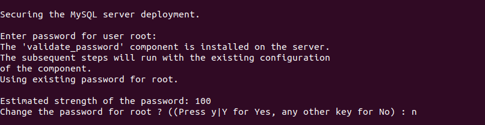
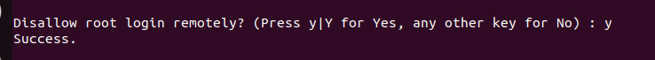

# Configuration of MySQL database server

For configuring the MySQL, the included security script was run to change some of the less secure default options. 

The following command was used to run the script. 
```bash
nikhil@vm-583017-ubuntu:~$ sudo mysql_secure_installation 
```
The followign steps were taken after running the script. 
1. The root password for mysql was set.
    

2. The anonymous users that are present by default in mysql for smoother installation were removed.
    

3. The root login was disallowed remotely. 
    

4. The "test" database installed by default in mysql for testing purpose was removed.
   
   
A dedicated user was created in MySQL and the privileges were granted to manage the database. 
```sql
CREATE USER 'dbadmin'@'localhost' IDENTIFIED WITH auth_socket;
```
The identification was set to **auth_socket** for authenticating the user from its username on operating system instead of using a traditional password. This was done in order to block other users to access MySQL. 
Since, no other user was explicitly added, no other user can access the MySQL except for dbadmin. 

A database was created for the website of Tesseract Consulting. 
```sql
CREATE DATABASE tesseract_db;
```
All the required privileges over the **tesseract_db** database were provided to the user **dbadmin**. 
```sql
GRANT SELECT, INSERT, UPDATE, DELETE, CREATE, DROP, REFERENCES, INDEX, ALTER ON tesseract_db.* TO 'dbadmin'@'localhost' 
```

The following documents were referred for performing the above tasks: 
1. [Digital Ocean - MySQL configuration](https://www.digitalocean.com/community/tutorials/how-to-install-mysql-on-ubuntu-20-04#step-3-creating-a-dedicated-mysql-user-and-granting-privileges)
2. [Geeks-for-Geeks](https://www.geeksforgeeks.org/mysql/mysql-grant-revoke-privileges/)
   [^1]

[^1]: Since, the Database Server was later replaced with MariaDB Database Server, The secure configuration steps were also taken for MariaDB. The details about this are given in [[Configuration of MariaDB Database Server]]