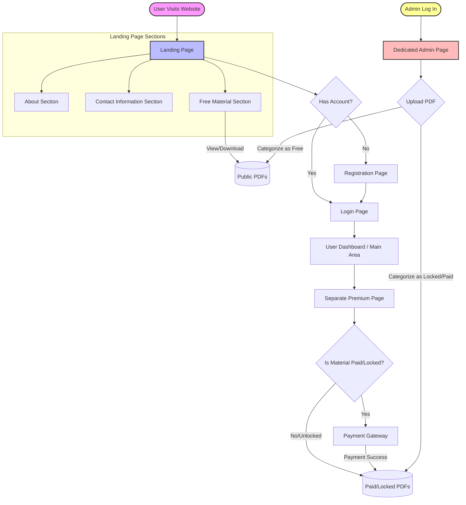
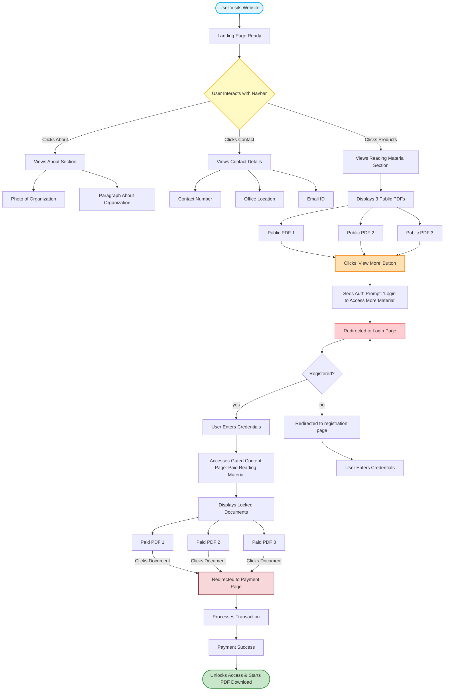
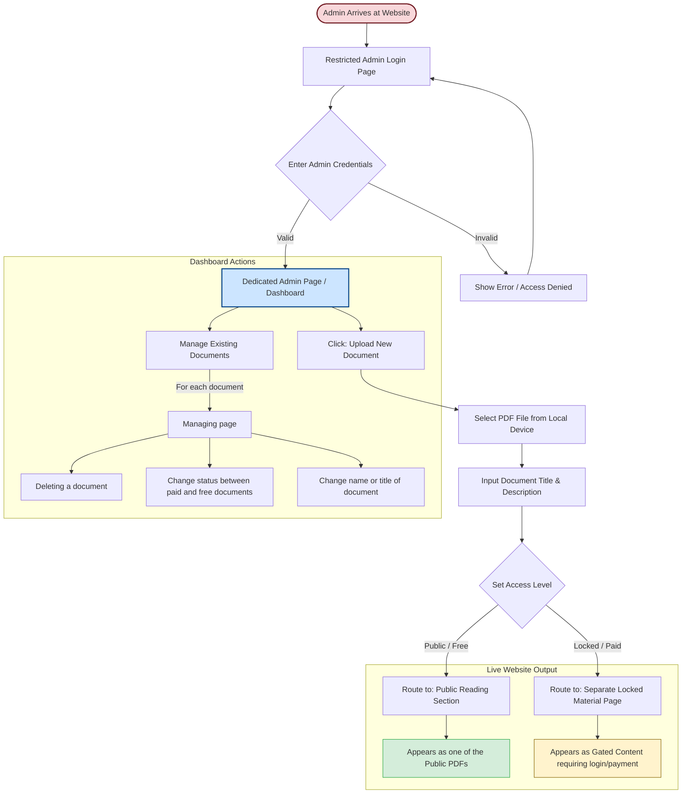

# Product Requirement Document 

#### Why? (Objective)
1. **For Business**:
       a) Establishing an online presence
       b) Reach out to the public and advertise and sell their product (IT and Cybersecurity Documents)
2. **For Users**:
       a)  Organized, easily accessible and secure platform for accessing the pdf documents

#### How do we measure success?
1. Good Search Engine Optimisation
2. Threat readiness of the website against data breaches
3. Easily manageable uploading of PDF's and security management for the website.

#### Who are the stakeholders?
1. Information providers (those who will upload documents)
2. Individuals who will be accessing materials from the site
3. Developers working further on the website
4. Persons dealing with the security of the website

#### Solution? 
A website whose working is as follows. 

#### Product Flow
**User flow**: The user flow is depicted by the following flow chart 

**Admin Flow**: The admin flow is depicted by the following flow chart 

#### Features 
1. Public access to free reading material
2. Only paid users can access the locked reading material
3. Authentication for the users, to register and login to the site (Registration and Google OAuth)
4. Admin page to add new pdf documents for the users, also it will be used to edit the contact details and about section (documents can be added to free as well as paid section)
5. Payment method to be added for locked reading material

#### Dependencies
1. **Technology Stack:**
| Component Type | Technology Selected | Application Responsibility & Security Function |
| :--- | :--- | :--- |
| **Logic Engine** | PHP 8.3+ | Orchestrates sessions, input validation, and file routing controls. |
| **Data Interface** | PHP PDO | Executes database operations; natively blocks SQLi via parameterized queries. |
| **UI Framework** | Bootstrap 5.x | Form and grid layouts; provides client-side presentation state. |
| **Identity/Auth** | Google OAuth 2.0 SDK | Federated sign-in logic; eliminates local password brute-forcing risk. |
| **FinTech/Payment** | Stripe PHP SDK | Checkout logic; processes access tokens via signed backend webhooks. |
