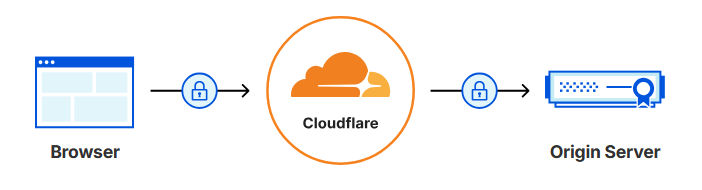

# Encrypting Data using SSL/TLS 

 The data transfer between the origin server and the users is as follows: 



The traffic moves between the clients (browser) and the origin server via the Cloudflare. This is because the cloudlfare acts as a reverse proxy between them. Thus, Cloudflare (proxy server) divides the connection between browser and the origin server into two halves. The SSL/TLS encryption is unavoidable to avoid interception and modification of data while transferring in these two halves. 

### Encrypting Data between Browser and Cloudflare (Edge Certificates)

The free plan of Cloudflare provides a Universal SSL certificate and a Backup certificate which encrypt data between the visitors of the domain and cloudflare. This is enabled by default in the Cloudflare settings.[^1]  

### Encrypting Data between Cloudflare and Origin Server (Origin Certificates)

The Origin Certificates encrypt the data transferred between Cloudflare and the Origin Server. The Origin Certificate was configured using the Cloudflare's built-in functionality. Cloudflare creates its own signed TLS certificates to install on our origin server. Moreover, the Cloudflare itself manages the renewal of the certificates when they get expired after 90 days. The maximum time period for which the certificate can be configured in Cloudflare is 15 years.

##### Implementation Steps for Configuring Origin Certificate
1. The Origin Certificate was selected from the Cloudflare Dashboard and the configuration page fpr the certificate was opened by clicking on add certificate. 

2. The following configurations were made in the certificate. 
    1. "Generate private key and CSR with Cloudflare" was toggled to create the Certificate Signing Request directly from Cloudflare. However, it can also be created in the origin server and pasted into Cloudflare. 
    2. ECC was selected as the Private Key Type. 
    3. The domain [tesseractconsulting.in]() and the wildcard pattern [*.tesseractconsulting.in]() was selected to generate the certificate. 
    4. The Certificate Validity was selected to 15 years. This means the certificate will be automatically renewed after every 90 days by Cloudflare for 15 years.
    5. The "Create" button was clicked and the Certificate as well as the Private Key were stored securely in separate files. 
    Thus, the certificate was configured on Cloudflare. 

3. The installation of the certificate was done on the Origin server as follows. 
   1. The certificate (Certificate.txt) and private key (Private_key.txt) files were stored in the **/etc/ssl/certs** and the **/etc/ssl/private** directories. (This is the default place where they are stored)
  
   2. The permissions for the Certificate file (Certificate.txt) and Private key (Private_key.txt) file were changed and the user and group were configured to match that of its parent directory (/etc/ssl/private). Additionally, since only read permissions are required, both the files were configured to provide only read permissions to its users and groups.
        ```bash
        nikhil@vm-583017-ubuntu:~$ ls -ld /etc/ssl/certs 
        drwxr-xr-x 2 root root 20480 Aug 23 11:55 /etc/ssl/certs/
        nikhil@vm-583017-ubuntu:~$ ls -ld /etc/ssl/private
        drwx--x--- 2 root ssl-cert 4096 Aug 23 12:23 /etc/ssl/private/
        nikhil@vm-583017-ubuntu:~$ sudo chown root:root /etc/ssl/certs/Certificate.txt 
        nikhil@vm-583017-ubuntu:~$ sudo chown root:ssl-cert /etc/ssl/private/Private_key.txt
        nikhil@vm-583017-ubuntu:~$ sudo chmod 440 /etc/ssl/certs/Certificate.txt
        nikhil@vm-583017-ubuntu:~$ sudo chmod 440 /etc/ssl/private/Private_key.txt
        ``` 

3. The configuration of the configuration files of the domain [tesseractconsulting.in](https://tesseractconsulting.in) were changed as follows. The following lines were added to the files for port 80 and port 443.[^2]
```bash
<VirtualHost *:80>
SSLEngine on 
SSLCertificateFile /etc/ssl/certs/Certificate.txt
SSLCertificateKeyFile /etc/ssl/private/Private_key.txt
</VirtualHost>

<VirtualHost *:443>
SSLEngine on 
SSLCertificateFile /etc/ssl/certs/Certificate.txt
SSLCertificateKeyFile /etc/ssl/private/Private_key.txt
</VirtualHost>
```
<!-- The configuration file for port 443 is made using the default configuration file named as "default-ssl.conf" given in the /etc/apache2/sites-available directory. -->

[^1]: The Cloudflare was configured to always redirect http traffic to https by toggling it in the Edge Certificates Tab in the SSL/TLS configuration in Cloudflare Dashboard. 

[^2]: The encryption mode was set to Full (strict) mode in the SSL/TLS tab in the Cloudflare once the Edge and Origin Certificates were configured. 

### HTTPS Health Check

Now, the accessibiiltiy to the domain [tesseractconsulting.in](https://tesseractconsulting.in) was checked by visiting it using the chrome browser, via "https". The following web page was observed. 

This shows that the website is successfully up and running.
