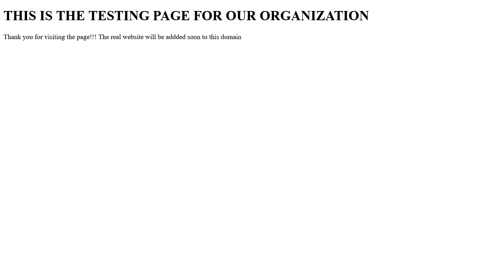

# Creating and Testing a HTML page

A Test page was created in the apache web server and assigned to the domain [tesseractconsulting.in](https://tesseractconsulting.in) which has been configured on the Cloudflare account. 
While performing this task, the DNS records had already been added to the domain in the cloudflare account. 

Steps taken: 

1. A directory named tesseractconsulting.in was made in the var/www directory in the Linux Server. This director is created automatically during the installation of apache web server.
```bash
nikhil@vm-583017-ubuntu:~$ mkdir /var/www/tesseractconsulting.in 
```
2. A index.html file was made inside the directory. 
```bash
nikhil@vm-583017-ubuntu:~$ touch /var/www/tesseractconsulting.in/index.html 
```
3. The HTML code for creating a test page was added to the file index.html.
```bash
nikhil@vm-583017-ubuntu:~$ sudo nano /var/www/tesseractconsulting.in/index.html 
```
HTML Code: 
```html
<!DOCTYPE html>
<html> 
<head> 
	<title>Welcome to Tesseract Consulting Services</title> 
</head> 
<body> 
	<h1>THIS IS THE TESTING PAGE FOR OUR ORGANIZATION</h1> 
	<p>Thank you for visiting the page!!! The real website will be addded soon to this domain</p> 
</body> 
</html> 
```
4. The user frontend-dev was given permissions to read and modify the index.html. 
```bash
nikhil@vm-583017-ubuntu:~$ sudo chown -R frontend-dev:www-data /var/www/tesseractconsulting.in/index.html 
```
5. The working of the website was tested by typing [http://tesseractconsulting,in](https://tesseractconsulting.in) in the web browser.

## HTTP Health Check 
The domain [tesseractconsulting.in](https://tesseractconsulting.in) was checked by visiting it with the help of the chrome browser.[^1] The following web page was observed which corresponds to the HTML code written for the testing website. 



The successful opening of this web page, concludes that the web server is recieving HTTP requests and responding to them efficiently. 

[^1]: Before the testing, it was ensured that the SSL/TLS encryption was configured to flexible. This was done only for testing purpose and the encryption mode was changed to full strict, once the SSL certificate was configured for the domain on the origin server. 
