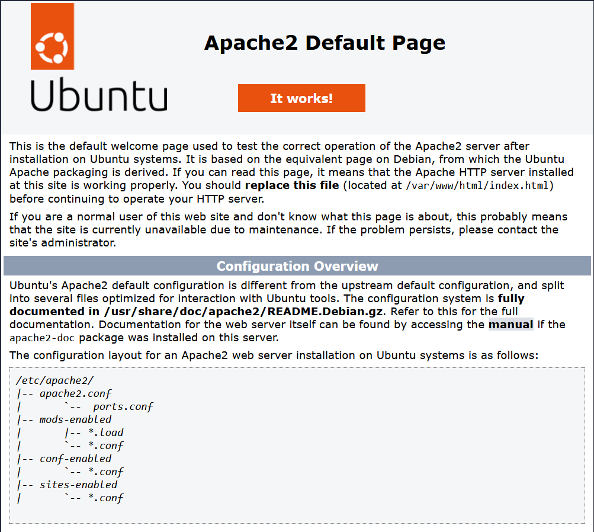

# LAMP Stack Installation 

**LAMP Stack**: It is a group of open source softwares which are used by developers to host and deploy dynamic websites and web applications. 

L | Linux | It provides the operating system of the physical server on which the other three applications exist and run via the processes. 
--|---|-
**A** | **Apache** | **It is the middleman. It recieves requests from the users and provides the output generated by the php to the user.** 
**M** | **MySql or Maria DB** | **It stores the necessary database to run the website such as user profiles, passwords etc.**  
**P** | **PHP** | **It runs the logic behind the website. It recieves the request details from Apache, interprets it, runs the required logic and sends the output back to the webserver in the form of HTML, CSS and JavaScript.** 

The LAMP Stack is highly efficient because:

1. It handles every part of a web request.

2. It is being widely used for over two decades. Therefore, almost every bug we would encounter while deploying and maintaining it is already solved. 

3. It is totally free of cost. 

4. It is highly flexible, because we can, at any time change its configuration file, swap the components (Apache --> Nginx) and scale individual layers as the traffic grows. 

**Installation of each component:**
1. **Apache**

**Steps Taken:**

a) The package manager cache was updated. \[[1](https://github.com/Spectrum75/All-is-well)]
```bash
nikhil@vm-583017-ubuntu:~$ sudo apt update
```
b) Apache was installed.
```bash
nikhil@vm-583017-ubuntu:~$ sudo apt install apache2
``````
c) The firewall settings were adjusted to allow the web traffic.
```bash
nikhil@vm-583017-ubuntu:~$ sudo ufw app list
Available applications:
  Apache
  Apache Full
  Apache Secure
  OpenSSH
```
**Command:**
```bash
nikhil@vm-583017-ubuntu:~$ sudo ufw allow in "Apache"
nikhil@vm-583017-ubuntu:~$ sudo ufw status
Status: active

To                         Action      From
--                         ------      ----
OpenSSH                    ALLOW       Anywhere
Apache                     ALLOW       Anywhere
OpenSSH (v6)               ALLOW       Anywhere (v6)
Apache (v6)                ALLOW       Anywhere (v6)
```

d) The final check for the installation was done by visiting the server IP address on the web browser.

* **IP address:** http://192.0.2.15



This web page represents the successful installation of Apache 2 server on the web page. 

2. **MySQL**

**Steps Taken:**

a) MySQL database system was installed.
```bash
nikhil@vm-583017-ubuntu:~$ sudo apt install mysql-server
```
b) The security script was run which comes preinstalled with MySQL which removes any default settings that may make the database system vulnerable. Anonymous users and test databases were removed, and remote login to the root account was disabled completely.
```bash
nikhil@vm-583017-ubuntu:~$ sudo mysql_secure_installation
```
c) Finally, login to the MySQL console was checked.
```bash
nikhil@vm-583017-ubuntu:~$ sudo mysql 
```
Note: The MySQL Database server was later replaced with MariaDB database server. As it could not be managed using webmin panel. Details about this are given in [[Database Server Change|Installation of MariaDB Database Server]]. 

3. **PHP**

**Steps Taken:**

a) All the PHP and related files were installed. The packages installed via this command are suitable and work seamlessely with both MySQL and MariaDB Database Server.
```bash
nikhil@vm-583017-ubuntu:~$ sudo apt install php libapache2-mod-php php-mysql
```
b) PHP version was checked to confirm its installation.
```bash
nikhil@vm-583017-ubuntu:~$ php -v
```


